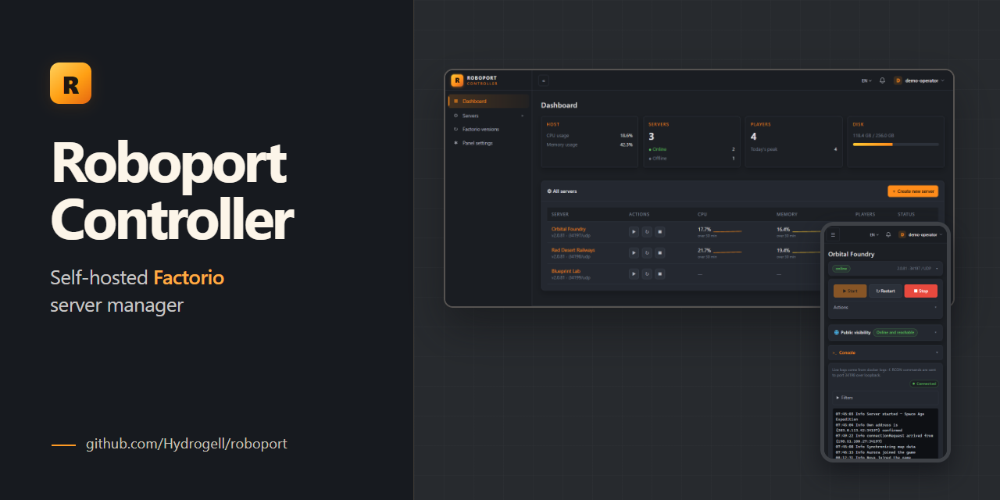
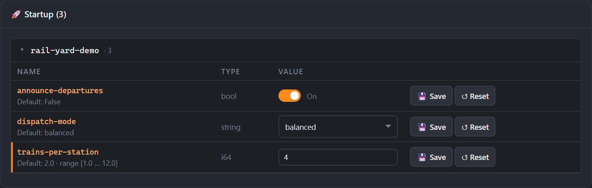
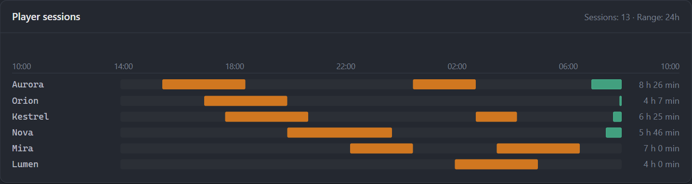

# Roboport Controller

**English** · [Русский](README.ru.md)　|　[Features](#features) · [Quick start](#quick-start) · [Documentation](#documentation)

Roboport Controller lets you manage multiple independent Factorio servers from a single self-hosted web panel. It reads the game and mod versions from a save, shows who’s playing on each server, and can warn players in chat before a scheduled restart. Run your servers at home or on a VPS and manage them from your phone.

[](docs/images/dashboard-en.png)

[Full-size dashboard](docs/images/dashboard-en.png) · [Console on a phone](docs/images/mobile-en.png)

## Features

**Start a new map or bring your factory along.** Set a map seed or turn on peaceful mode for a new world. If you already have a factory, upload its save ZIP when creating the server. Roboport checks the Mod Portal for the mod versions recorded in the save first. When you switch saves, it keeps a copy of the previous world. [See the Saves tab](docs/images/server-en.png)

**Build and tune a mod pack.** Search the Factorio Mod Portal or drop your `mod-list.json` or mod ZIPs into the panel. Choose which mods to update. Roboport opens the game’s `mod-settings.dat` as a form with switches, dropdowns and number fields. Each setting has a button to restore the mod author’s default.

[](docs/images/mod-settings-en.png)

**Play with friends or open your server to everyone.** Set a password and an allowlist for a private world, or list a public game in Factorio’s server browser. Grant in-game admin rights or ban a player with a reason. If a friend can’t join a public server, the panel shows its public address and the reasons Factorio logged for recent rejections.

**See who played and when.** Each player gets a row on the session timeline. See who played together, spot peak hours and check CPU and memory use over the same period. You can also set the game to pause when the last player leaves.

[](docs/images/player-sessions-en.png)

**Run the server from your browser.** Follow the live log or use the RCON console with autocomplete for Factorio commands, player names and Lua functions. Open configuration files in the built-in editor. Schedule a save every half hour or a restart on a particular day, with an optional countdown in game chat.

## Quick start

Download and extract the source archive from the [**v1.0.0 release**](https://github.com/Hydrogell/roboport/releases/tag/v1.0.0). Open a terminal in the directory containing `VERSION`.

**Linux · Debian or Ubuntu.** Run the installer on a host with `sudo` access.

```bash
INSTALL_SYSTEMD=yes INSTALL_NGINX=yes INSTALL_TLS=selfsigned bash deploy/install.sh
```

The installer starts Roboport as a service. Open `https://SERVER-IP/` and compare the certificate fingerprint with the one the installer printed.

**Windows 11 · Docker Desktop.** Run the installer in PowerShell.

```powershell
powershell -ExecutionPolicy Bypass -File .\deploy\install.ps1
```

Start Docker Desktop in Linux container mode. If the script just installed Docker Desktop, run the command again. Then open `start.bat` and go to `http://127.0.0.1:8000/`.

On the first visit, enter the setup code printed by the installer and create your administrator account. Choose **Servers → Create new server**, select a game version, create the server and click **Start**. In Factorio multiplayer, connect to the host address and UDP port shown in the panel.

## Compatibility and architecture

Each Factorio server has its own Docker container and UDP port. The `factoriotools/factorio` image tag sets the game version. Worlds, mods and configuration live on the host in `servers/<uuid>/`. You can clone a stopped server with all three and assign it a new port. Mod Portal downloads and public game listings use your Factorio.com account.

Roboport uses Python, FastAPI and Jinja2, with SQLite for settings and history. The interface is available in 30 languages. Enable two-factor authentication for sign-in or turn on streamer mode to blur IP addresses on screen.

Give a bot a read-only REST API key so it can report player counts and server load. Signed webhooks can notify it when a server starts or a player joins (`player.joined`). Explore the interactive API reference at `/api/v1/docs` on your installation.

## Documentation

- [Operator guide](deploy/README.md) — HTTPS, backups and panel updates with automatic rollback on Linux.
- [Recover a password, username or lost authenticator](deploy/README.md#access-recovery) · [Troubleshoot startup and connection issues](deploy/README.md#troubleshooting-and-references).
- [REST API and webhooks](docs/api.md) · [Interface translation](docs/localization.md) · [Security and vulnerability reports](SECURITY.md).

Roboport Controller is an independent community project, developed without affiliation with or endorsement by Wube Software Ltd. Factorio and its game assets belong to Wube. [Factorio terms](https://www.factorio.com/terms-of-service) · [Roboport MIT license](LICENSE) · [Third-party notices](app/static/THIRD_PARTY_NOTICES.md)
