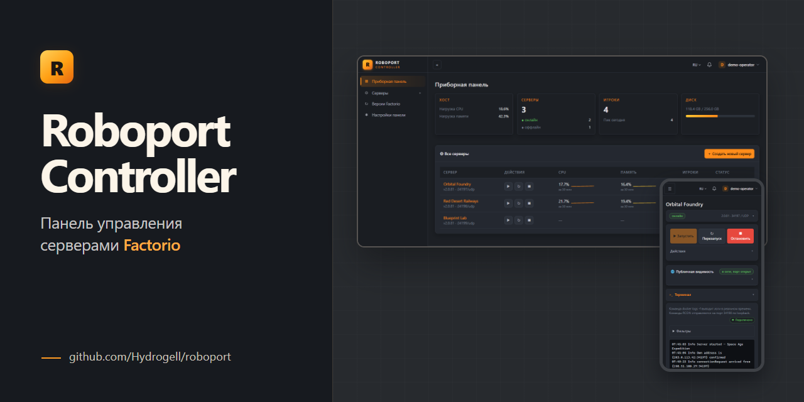
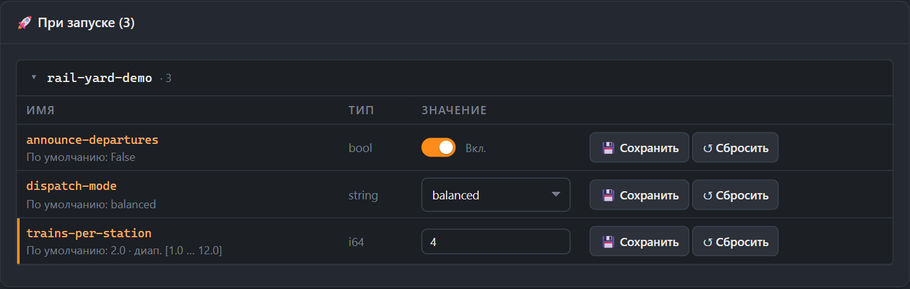
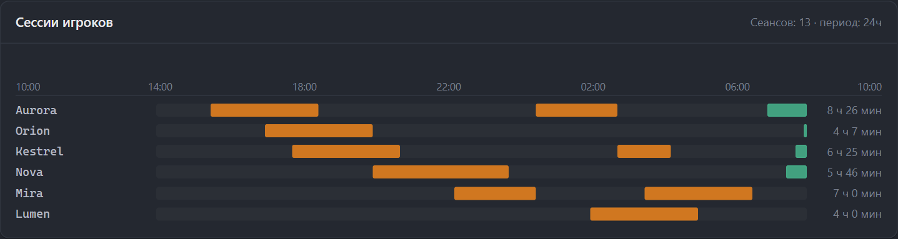

# Roboport Controller

[English](README.md) · **Русский**　|　[Возможности](#возможности) · [Быстрый старт](#быстрый-старт) · [Документация](#документация)

Roboport Controller позволяет управлять несколькими независимыми серверами Factorio из одной веб-панели. Она подбирает версию игры и моды по сохранению, показывает, кто играет на каждом сервере, и умеет предупреждать игроков в чате перед плановым рестартом. Серверы можно держать дома или на VPS, а управлять ими — даже с телефона.

[](docs/images/dashboard-ru.png)

[Приборная панель крупным планом](docs/images/dashboard-ru.png) · [Терминал на телефоне](docs/images/mobile-ru.png)

## Возможности

**Начать с новой карты или продолжить свою.** Для нового мира можно задать сид и включить мирный режим. Если карта уже есть, загрузи ZIP-сохранение при создании сервера. Roboport прочитает список модов и сначала поищет на Mod Portal те версии, с которыми ты играл. При смене активного сохранения предыдущий мир останется отдельным архивом. [Сохранения в панели](docs/images/server-ru.png)

**Собрать и настроить моды.** Найди моды на Factorio Mod Portal или перетащи в панель свой `mod-list.json` либо архивы модов. При выходе обновлений отметь, какие из них установить. Игровой файл `mod-settings.dat` открывается как форма с переключателями, списками и числовыми полями. Кнопка рядом с параметром возвращает значение, заданное автором мода.

[](docs/images/mod-settings-ru.png)

**Играть своей компанией или открыть сервер для всех.** Защити мир паролем и списком разрешённых игроков или опубликуй его в списке серверов Factorio. Из панели можно назначить игрового администратора или заблокировать игрока, указав причину. Если друг не может зайти на публичный сервер, здесь видны внешний адрес и причины последних отказов из журнала игры.

**Посмотреть, кто играл и когда.** На шкале сессий у каждого игрока своя строка. Видно, кто играл вместе, когда было больше всего людей и как в это время менялись нагрузка на процессор и расход памяти. А если хочешь, чтобы фабрика ждала игроков, включи автоматическую паузу, когда сервер пуст.

[](docs/images/player-sessions-ru.png)

**Обслуживать сервер из браузера.** Журнал обновляется в реальном времени, а консоль RCON подсказывает команды Factorio, имена игроков и функции Lua. Рядом есть файловый менеджер с редактором конфигурации. Можно настроить сохранение мира каждые полчаса или назначить рестарт на нужный день и время с обратным отсчётом в игровом чате.

## Быстрый старт

Скачай архив исходников со [страницы релиза **v1.0.0**](https://github.com/Hydrogell/roboport/releases/tag/v1.0.0), распакуй и открой терминал в папке с файлом `VERSION`.

**Linux · Debian или Ubuntu.** Для установки нужен доступ к `sudo`.

```bash
INSTALL_SYSTEMD=yes INSTALL_NGINX=yes INSTALL_TLS=selfsigned bash deploy/install.sh
```

Установщик запустит панель как службу. Открой `https://IP-СЕРВЕРА/` и сверь отпечаток сертификата с выводом установщика.

**Windows 11 · Docker Desktop.** Запусти установщик из PowerShell.

```powershell
powershell -ExecutionPolicy Bypass -File .\deploy\install.ps1
```

Запусти Docker Desktop в режиме Linux-контейнеров. Если Docker Desktop поставил сам установщик, повтори команду. Затем открой `start.bat` и перейди на `http://127.0.0.1:8000/`.

При первом открытии введи код из терминала установщика и создай аккаунт администратора. Открой **Серверы → Создать новый сервер**, выбери версию игры, создай сервер и нажми **Запустить**. В сетевой игре Factorio укажи адрес хоста и UDP-порт из панели.

## Совместимость и устройство панели

У каждого сервера Factorio свой Docker-контейнер и UDP-порт. Версию игры задаёт тег образа `factoriotools/factorio`. Миры, моды и конфигурация лежат на хосте в `servers/<uuid>/`. Остановленный сервер можно клонировать вместе с этими файлами на другой порт. Для скачивания модов с портала и публикации сервера в списке игры нужен аккаунт Factorio.com.

Панель написана на Python с FastAPI и Jinja2, настройки и история хранятся в SQLite. Интерфейс доступен на 30 языках. Для входа можно включить двухфакторную аутентификацию, а для показа панели на стриме — размытие IP-адресов.

Своему боту можно выдать ключ REST API с правом чтения, чтобы он показывал онлайн и нагрузку сервера. Подписанные вебхуки сообщат, например, о запуске сервера или входе игрока (`player.joined`). Интерактивный справочник доступен в панели по адресу `/api/v1/docs`.

## Документация

- [Руководство администратора](deploy/README.ru.md) — HTTPS, резервные копии и обновление панели с автоматическим откатом на Linux.
- [Восстановить пароль, логин или двухфакторный доступ](deploy/README.ru.md#восстановление-доступа) · [Разобраться с запуском и подключением](deploy/README.ru.md#диагностика-и-ссылки).
- [REST API и вебхуки](docs/api.md) · [Как добавить перевод](docs/localization.md) · [Безопасность и сообщения об уязвимостях](SECURITY.md).

Roboport Controller — независимый проект сообщества. Панель разработана без участия и официального одобрения Wube Software Ltd. Права на Factorio и игровые ресурсы принадлежат Wube. [Условия Factorio](https://www.factorio.com/terms-of-service) · [Лицензия Roboport (MIT)](LICENSE) · [Лицензии компонентов](app/static/THIRD_PARTY_NOTICES.md)
